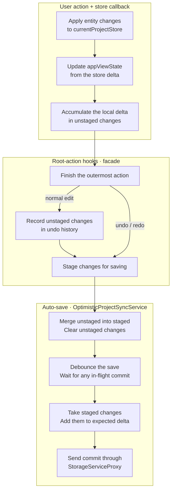
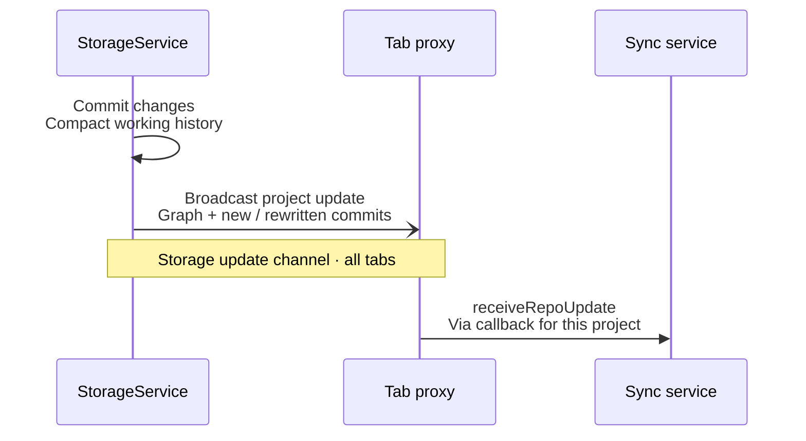
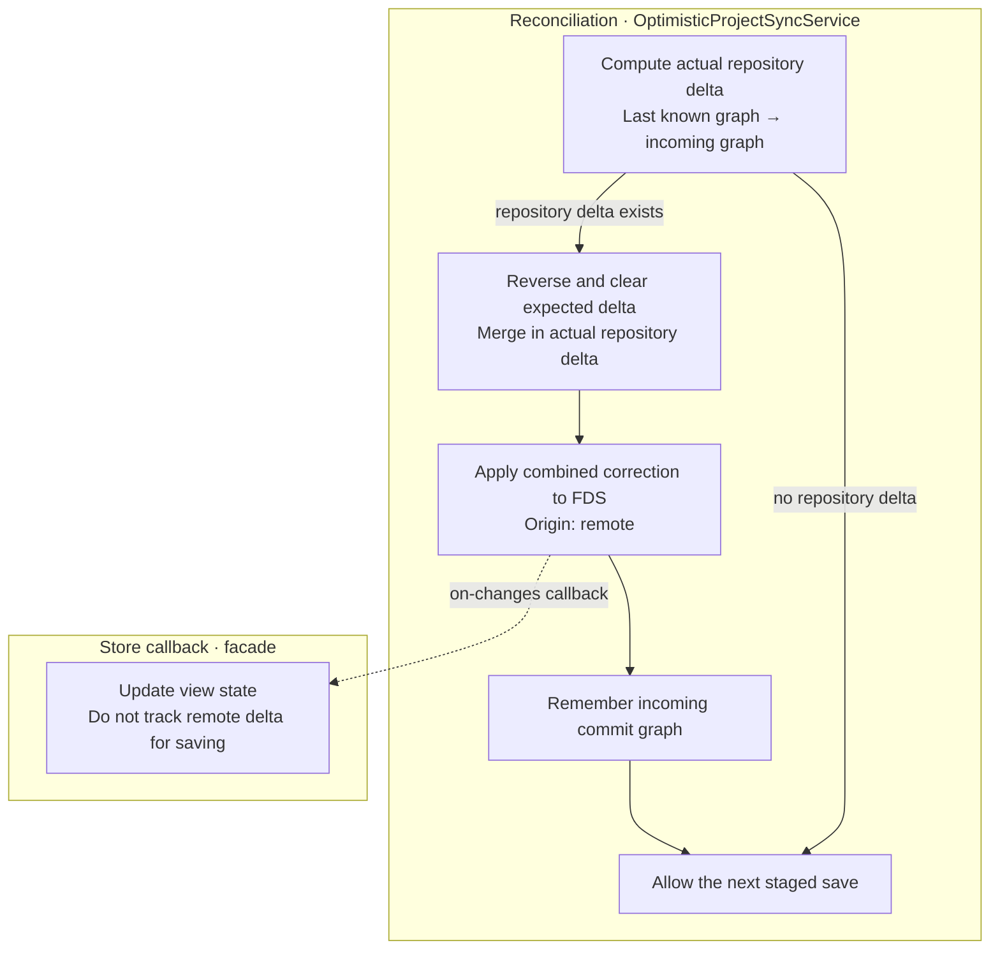
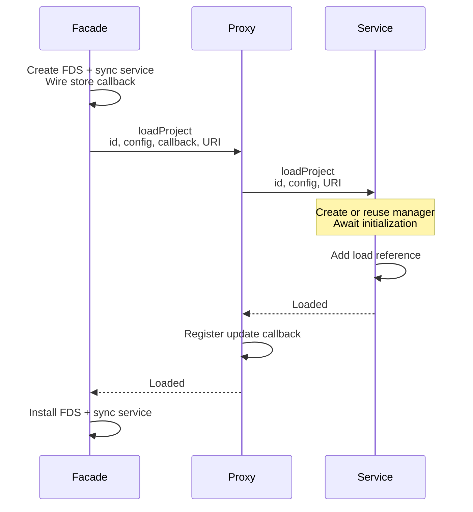
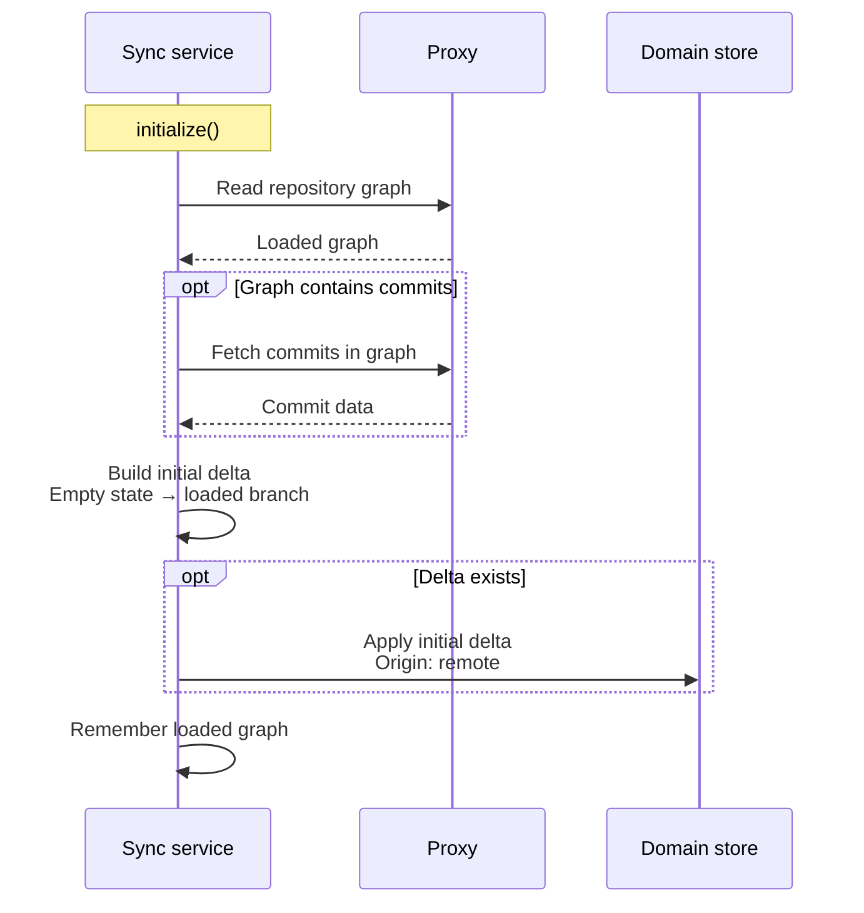
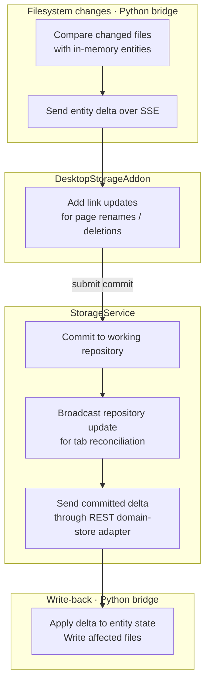
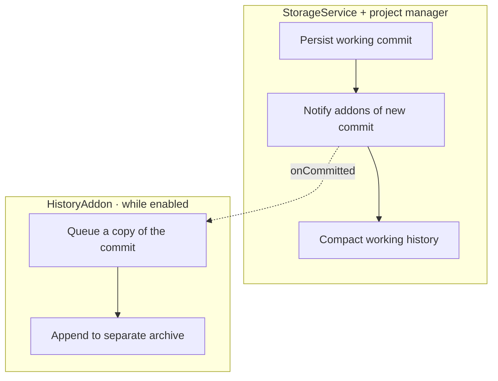

# Storage system

For SivKit adapter choices and setup examples, see [TypeScript storage setup](https://github.com/v-ko/sivkit/blob/dev/docs/storage-setup.md). This page describes Pamet's storage and the design behind it.

## Version control system
Pamet has a version control system (part of SivKit). It's used to track changes for the purposes of communicating them efficiently and managing state. Inter-tab sync is implemented; auto-merging collaborative edits and synchronization between devices are design goals described below. Undo/redo is handled separately on the change-set level.

Since the idea is very much centered around owning your data - file-system storage is a first-class citizen. The VCS is mainly present for tracking the changes and communicating them as stated above. To optimize this for the data most used by the app - we treat some files as collections of objects (canvas pages) and others as blobs (basically everything else). For blobs that are referenced - we keep the path and content hash in the repo, not the blob itself. For app collections - we commit all entity content. Native Markdown integration is still planned. See [content/blob decision](https://github.com/v-ko/sivkit/blob/dev/docs/adr/100-vcs-content-tracking-and-blob-storage.md) for the rationale.

**It differs from git in that commits have random IDs and content hashes depend only on the repo snapshot**. So changes to the previous nodes in the branch will not cause a hash change in a later commit if its resulting snapshot stays the same. But also hashes cannot be used as IDs or for integrity checking of the chain-of-changes. This is the case because we want to be able to compact (squash) parts of branches without the need to rebase. Changes are staged after root actions and saves may batch several actions into one commit. Without squashing, frequent commits would quickly cause overhead on repo-load and device sync. The working VCS is not the full history archive. See the [delta protocol](https://github.com/v-ko/sivkit/blob/dev/docs/delta-protocol.md) for change and replay semantics.

## HashTree
The hash tree optimizes the content-hash compute time for the repo/store by updating affected parts. Each commit records the resulting snapshot hash.

There was a question whether to add the folders as objects, so that we further normalize the tree, but that's too much complexity for little practical gain. The original scale assumption was 1–5k pages/collections per project, 20k worst case. At that scale, string concatenation and hashing at commit time was not considered a reason to add another folder-object layer.

### Local changes and auto-save
Actions edit the frontend domain store (currentProjectStore) synchronously. Its on-changes callback updates view state and passes the same delta to `OptimisticProjectSyncService`. Remote-origin changes still update the view state, but are not tracked for another save.

The SivKit action framework runs completion hooks after the root action, not after each nested action call. For user actions, the facade records undo before staging the changes for saving. Undo/redo also save, but do not create new undo steps. Saves can batch several root actions, rather than making one commit per action.

The sync service tracks three deltas: **unstaged** changes since the last staging, **staged** changes waiting to be sent, and **expected** changes already sent but not yet reconciled with a repo update. All are already reflected in the FDS; they are not separate stores. The UI can continue changing while a save is in flight.

### Repository updates and optimistic reconciliation
**Update delivery.** After a commit, `StorageService` broadcasts the project's commit graph and the new or rewritten commits, including any history compaction. Each tab's `StorageServiceProxy` routes the update by project ID to its registered `receiveRepoUpdate` callback. The saving tab receives updates through the same path as other tabs; external filesystem edits also enter this path after being committed.

Commit requests and their results travel separately through the proxy's Comlink calls (or direct calls in main-thread mode). The broadcast carries the repository changes used to reconcile each tab.

**Reconciling the frontend domain store.** Local edits are already visible in the FDS before the repository update arrives, so the committed changes cannot simply be applied as if the store still held the previous committed state. `OptimisticProjectSyncService` computes the actual repository delta from its last known commit graph to the incoming graph, then combines it with the reverse of the expected delta. It applies that combined correction to the FDS in one store operation and remembers the incoming graph.

If the actual delta matches the expectation and there are no other changes, the correction cancels out and the FDS content stays the same. Otherwise it reflects what was actually committed, including changes from other tabs or the filesystem and local changes skipped because of conflicts with the repository head.

The correction uses origin `remote`, so the store callback updates view state without scheduling another save. Here, `remote` means an update from the storage service, including this tab's own save—not necessarily another device or network peer.

### Opening a project
The facade creates the tab's FDS and sync service, connects the store callback, and passes `receiveRepoUpdate` as the project's update handler when loading. The proxy keeps that handler locally; it is not a callback passed into the worker. Initial hydration reads the graph and its commits, then computes the delta needed to populate the empty tab store.

**1. Load the shared project storage.** `Proxy` is `StorageServiceProxy`; `Service` is `StorageService` in the SharedWorker.

**2. Hydrate the tab's domain store.** The tab starts with an empty frontend domain store. The facade calls `OptimisticProjectSyncService.initialize()`, which reads the loaded repository's commit graph and commits through the proxy. Using `computeRepoSyncDelta`, it builds the delta from an empty graph to the project's current branch state, applies it to the store and remembers the loaded graph as the starting point for later updates.

The proxy forwards reads to `StorageService`. Applying the initial delta triggers the store callback, which updates view state without tracking the data for another save (`remote` origin). After hydration, the facade initializes search and replay services.

On desktop, manager initialization establishes the filesystem bridge and reads entities through the domain-store adapter to hydrate the repository's committed store. The tab still hydrates through the graph/commit path above. Offline web reconstructs state from the working VCS without a separate domain-store adapter.

| Mode | Working VCS | Entity files | Media |
| --- | --- | --- | --- |
| Desktop | IndexedDB | Project folder through REST | REST |
| Offline web | IndexedDB | Reconstructed from VCS | CacheAPI |

A separate service worker serves cached media in web mode; it does not own the repository.

## Desktop filesystem integration and history
Desktop integration belongs with the project manager and storage service rather than autonomous adapters: filesystem edits and tab saves need to enter the same commit path, and entity files need to reflect what was actually committed. The Python bridge manages the project folder; the REST domain-store adapter reads its entities and writes committed deltas. `DesktopStorageAddon` establishes the bridge and subscribes to its filesystem-change stream.

### Filesystem changes and write-back
The bridge compares changed files with its in-memory entity state and sends the resulting deltas over SSE. Before submitting a delta to `StorageService`, `DesktopStorageAddon` adds link updates for page renames and deletions, using the repository's committed store to find affected notes.

Tab saves enter at the same commit operation. `StorageService` serializes commits with the per-project Web Lock, updates the working repository, broadcasts the resulting graph and commits to tabs, then sends the committed entity delta to the bridge. For a filesystem-originated commit, the original edit is already on disk; write-back also carries any added link updates. The bridge compares state before writing, and its watcher ignores unchanged file content, so writing back does not create another change loop.

Media uses the separate file-store adapter (REST on desktop, CacheAPI offline), not this entity-delta path.

### Optional full-history recording
The working VCS is compacted to keep restoration and reconciliation small. `HistoryAddon` keeps a separate archive of commits observed while `recordAllChanges` is enabled. The project manager notifies the addon of each new commit before working-history compaction; the addon queues a copy and appends it to the archive on its own history chain.

The archive is a backend SQLite database on desktop and a separate IndexedDB store offline. Enabling recording first verifies the archive and reconciles its head with the current committed project state, adding a patch if they differ. This captures the current state after a recording gap, not each individual edit made while recording was disabled. Working-history compaction does not compact the archive.

## Storage format migrations

Pamet has evolved through multiple storage format versions. The migration system handles upgrading from legacy formats to the current version.

**Migration documentation**:
- [V2 to V3 Migration](migrations/v2-to-v3.md) - Legacy Misli (.misl) to JSON format
- [V3 to V4 Migration](migrations/v3-to-v4.md) - JSON to paginated format with proper IDs
- [V4 to V5 Migration](migrations/v4-to-v5.md) - Type unification, color roles, arrow restructuring

See the [Migration Manager implementation](../server/pamet/storage/migrations/manager.py) for details on migration orchestration.

## Notes from the storage design
The goals and peer-sync proposal below are design notes, not a description of an enabled WebRTC or collaboration setup. The current implementation above covers offline storage, inter-tab sync and the desktop bridge.

- Use cases relevant to the problem
	- Offline work and device sync
	- Inter-tab sync, desktop server sync
	- Sharing
	- Real-time collab
	- Undo/redo - handled on the change-set level, not through the persistence VCS
	- Backups - separate on-device, non-synced service
	- Full change history retention - separate on-device, non-synced storage
	- Media sync
		- The fetch source can be swapped by intercepting requests in a service worker. The browser cache can then be used while the media source changes.

- Constraints/requirements for device sync
	- Possibly without accurate time sync for every node
	- Able to tolerate long offline periods and multiple changes (offline work)
	- Multi-device, multi-user state syncing with automatic conflict resolution. The original proposal accepts dropping conflicting changes by node seniority.

The original hashing experiment (200 changed leaves of about 750 characters plus 15,000 unchanged leaves) took about 160ms under browser low-end-mobile throttling. That motivated moving commit/hash work off the UI thread.

### Proposed device-sync flow
- User and service actions produce changes to the state on each node. Change objects hold forward/reverse differences at the first-level entity-property granularity (content/metadata/etc.).
- Each device writes to its own branch. The proposed peer transport exchanges commit graphs and missing commits. The original transport idea was a y-js WebRTC adapter.
- Each node has a seniority index (its place in the branch table/list). If several nodes change state in the same sync window, junior nodes adopt the senior state and reduce their own changes to remove conflicts, then re-add non-conflicting changes. Once the senior node has no conflicts, it adopts the junior commits.
- A sync window is the span between merge-handler runs. If only one branch has new commits, other nodes adopt them regardless of seniority. With competing branches, the most senior waits for others to adapt first.
- For conflicting first-level properties, the proposed reconciliation reverses local commits, applies the senior commits, then reapplies reduced local commits.
- In the proposal, shared old history can be squashed after nodes adopt it, reducing restore and sync costs. The current service instead compacts a local history prefix by age; it does not wait for peer acknowledgements.
- Node dropout: a bounded commit buffer cannot retain changes indefinitely for a node that has not synced for a while. That node can be treated as junior and resynced before restoring its normal status, potentially with user approval. This is not necessarily deauthorization.

The original discussion is in [Issue #21](https://github.com/v-ko/pamet/issues/21), [PR #28](https://github.com/v-ko/pamet/pull/28) and [Issue #22](https://github.com/v-ko/pamet/issues/22).
