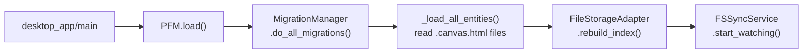
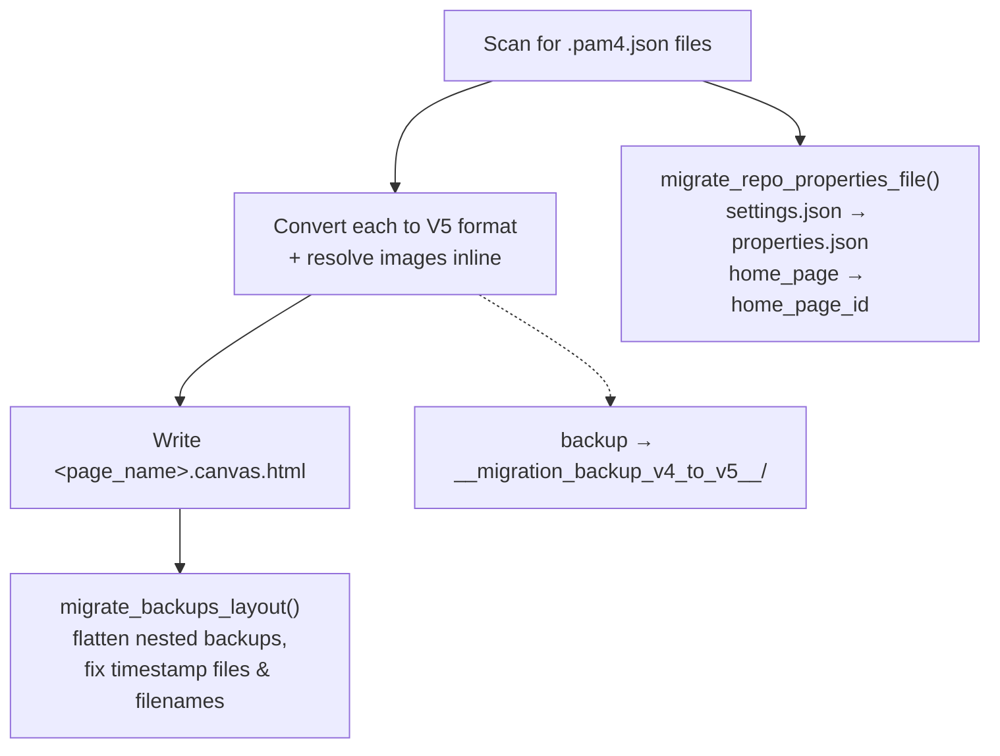
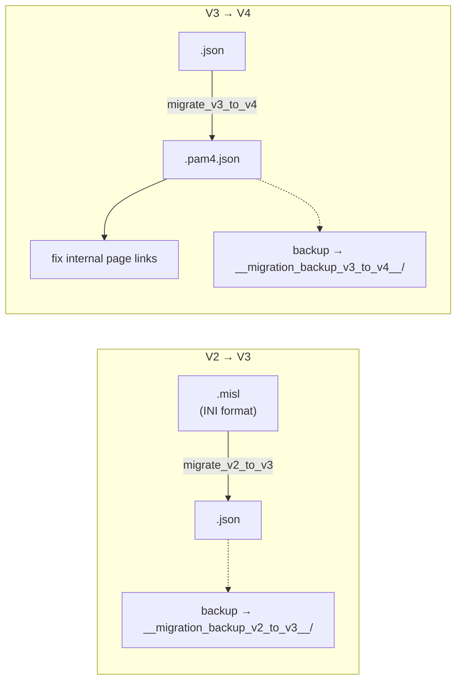

# Migration operations

The migration process assumes that we transition from one major version to another, and that we're mostly migrating pamet's internal files configs/backups/etc and the canvas page files. All other files (including media) should be ignored. Failed canvas file migrations should be reported but the migration should not interrupt. Only if all migrations fail - should we raise some critical error and abort. The source files (before migration) are moved to a backup folder to avoid data loss.

Special operations upon migration may include:
* Model corruption fixes (duplicate ids, bad note/arrow properties (because of bugs))
* Hyperlink fixes (page link fixes upon id schema changes)

## Project load sequence

## Automatic migration (V4→V5)

Only V4→V5 runs automatically because `.pam4.json` files are unambiguous. Runs inside `migrate_v4_to_v5(repo_path)`, called by the MigrationManager:

1. **Page conversion**: Each `.pam4.json` is converted to `<page_name>.canvas.html` with schema version 5. Image notes are resolved in the same pass — images under `.pamet/media/` or outside the repo are copied to `<repo>/images/`, images already in user-facing folders stay in place. Notes get `content.image: { path, width, height, hash }` with inline references (no separate entity). Internal link notes get `content.page_ref` and `content.text` set to the target page name.
2. **Repo properties migration**: `.pamet/settings.json` → `.pamet/properties.json`, key rename `home_page` → `home_page_id`
3. **Backup layout migration**: Flattens nested `backups/backups/`, moves timestamp files into the backups dir, fixes doubled `+` in backup filenames

Details: [v4-to-v5.md](v4-to-v5.md)

## Manual (mega-legacy) migrations

V2→V3 and V3→V4 must be invoked manually due to ambiguous file extensions (`.misl`, `.json`):

- **V2→V3** (`v2_to_v3.py`): Parses INI-like `.misl` files into `.json`. Handles duplicate IDs, property renames, arrow extraction. Details: [v2-to-v3.md](v2-to-v3.md)
- **V3→V4** (`v3_to_v4.py`): Introduces page IDs, composite element IDs, coord scaling (×20), note type specialization from text prefixes, arrow geometry inference, post-migration internal link fixing. Details: [v3-to-v4.md](v3-to-v4.md)

## Version format summary

| Version | Extension | ID Format | Colors | Note Types | File Naming |
|---|---|---|---|---|---|
| V2 | `.misl` | Integer per page | `"r;g;b;a"` string | Text prefix | `<page_name>.misl` |
| V3 | `.json` | Integer per page | `[r,g,b,a]` array | Text prefix | `<page_name>.json` |
| V4 | `.pam4.json` | `[page_id, own_id]` | `[r,g,b,a]` normalized floats | `TextNote`, `ImageNote`, `ScriptNote`, `CardNote` | `<slug>-<page_id>.pam4.json` |
| V5 | `.canvas.html` | `"pageId-ownId"` string | Named color roles | `CardNote` (unified) | `<page_name>.canvas.html` |
